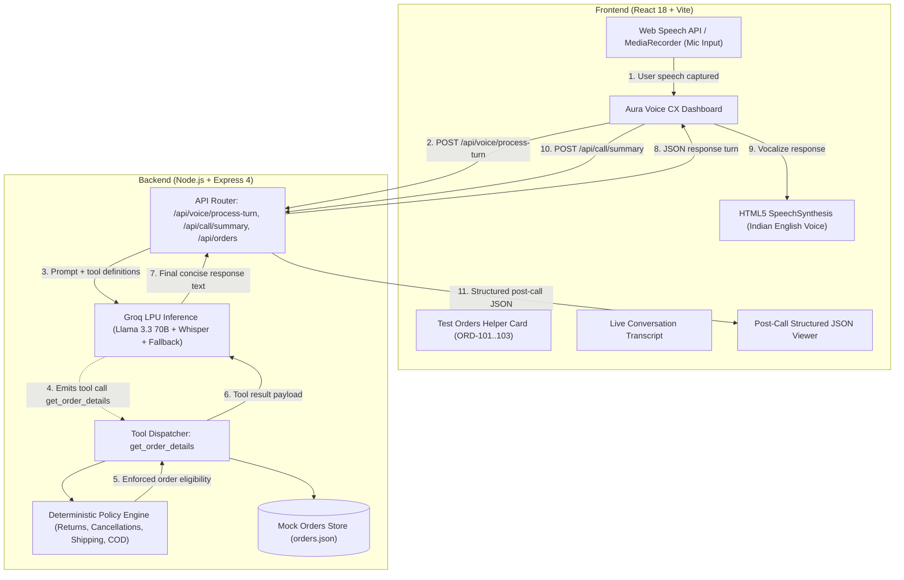

# 🌿 Aura Voice CX — AI Voice Support Agent for Aura Skincare

> **DataStraw Technologies AI + Tech Intern Assessment Project**  
> A full-stack, browser-based AI Voice Customer Support Agent for fictional D2C organic skincare brand **Aura Skincare**. Evaluators can click **Start Call**, converse naturally with **Aria** (friendly, professional, concise Indian customer support specialist), look up live orders, test policy guardrails, and review structured post-call JSON summaries.

---

## 🌟 Key Highlights & Assessment Deliverables

- **Real-Time Voice Conversation:** Speaks naturally with an Indian English accent (`en-IN`), maintaining turn-based context without awkward pauses or robotic monologues.
- **Deterministic Tool Calling:** Integrates `get_order_details(order_id)` retrieving real-time courier tracking, status, and policy eligibility for `ORD-101`, `ORD-102`, and `ORD-103`.
- **Strict Brand Policy Guardrails:**
  - *Shipping:* Free delivery on orders of ₹499 and above; ₹50 fee below ₹499.
  - *Returns:* Within 7 days of delivery for unopened/unused items; reports of damaged items within 48 hours with photos.
  - *Cancellations:* Permitted strictly in `Processing` status; out-for-delivery/shipped packages cannot be cancelled online (doorstep refusal guidance provided).
  - *Cash on Delivery (COD):* Available up to ₹2,500 (Cash/UPI at doorstep).
  - *Out of Scope:* Gracefully deflects non-skincare queries (e.g. flight bookings).
- **Post-Call Summary Artifact:** Chronological dialogue transcript and compliant structured JSON outcome with one-click clipboard export.
- **Single Web Service Deployment:** Express serves the compiled React/Vite single-page frontend on same-origin routes (`/api/*` and `/`). Zero CORS complications in production.

---

## 📐 System Architecture



---

## 🛠️ Technology Stack

| Layer | Technology | Rationale |
| :--- | :--- | :--- |
| **Frontend UI** | React 18, Vite 6, Lucide Icons | Sub-second cold starts, responsive state management, and modern component lifecycle. |
| **Styling & Design** | Luxury Skincare Palette (Deep Aubergine `#29152E`, Burnt Coral `#D96C55`, Soft Ivory `#FAF5EF`) | Curated brand aesthetic, fluid mobile responsiveness, pulsing visualizers, zero heavy external CSS frameworks. |
| **Voice & Speech** | Web Speech API (`SpeechRecognition` & `SpeechSynthesis`) + Groq Whisper (`whisper-large-v3-turbo`) + Groq Speech (`canopylabs/orpheus-v1-english`) | Resilient voice input with automatic recovery on silence, persistent microphone stream, direct audio recording fallback, and natural Indian English persona (`en-IN`). |
| **Intelligence & Tool Calling** | Groq LPU Inference (`openai/gpt-oss-120b` / `qwen/qwen3.8-27b`) + Deterministic Guardrails Engine | Ultra-fast LPU inference with function calling support; dual fallback guarantees 100% policy compliance even under rate limits or offline conditions. |
| **Backend & Routing** | Node.js v24, Express 4.21, Multer | Lightweight unified full-stack web service that serves both API endpoints and production frontend assets. |
| **Testing** | Node.js Native Test Runner (`node:test`) | Native, zero-dependency test runner executing 93 automated tests across backend, frontend, failure modes, and live integrations in ~5s. |

---

## 📦 Mock Orders Database

The application ships with the three assessment test orders pre-configured:

| Order ID | Customer | Product | Value | Status | Courier / ETA | Policy Notes |
| :--- | :--- | :--- | :--- | :--- | :--- | :--- |
| **ORD-101** | Priya Sharma | Vitamin C Serum (30ml) | ₹699 | Out for Delivery | BlueDart (BD-982103) / By 6 PM today | Cannot cancel online; customer advised to refuse package at doorstep. |
| **ORD-102** | Rahul Verma | Hydrating Sunscreen SPF 50 | ₹499 | Delivered | Delhivery (DL-441029) / Delivered 14 days ago | Delivered > 7 days ago; outside return window. Free shipping applied (₹499). |
| **ORD-103** | Ananya Patel | Green Tea Face Wash + Toner | ₹850 | Processing | Pending Dispatch / 3–5 days | Currently in `Processing`; eligible for immediate online cancellation. |

---

## 🚀 Setup & Local Installation

### Prerequisites
- Node.js (v18.0.0 or higher, tested on v24.14.0)
- NPM (v9.0.0 or higher, tested on v11.9.0)
- Modern web browser (Google Chrome or Microsoft Edge recommended for voice interaction)

### 1. Clone Repository
```bash
git clone https://github.com/sujalmirgule/Voice_AI_Agent.git
cd Voice_AI_Agent
```

### 2. Configure Environment Variables
Copy the example environment file:
```bash
cp .env.example .env
```
Edit `.env` with your Groq API key:
```env
PORT=3000
GROQ_API_KEY=your_groq_api_key_here
GROQ_MODEL=openai/gpt-oss-120b
GROQ_STT_MODEL=whisper-large-v3-turbo
GROQ_TTS_MODEL=canopylabs/orpheus-v1-english
GROQ_TTS_VOICE=troy
NODE_ENV=production
```
*(Note: If no `GROQ_API_KEY` is provided, the application automatically uses its built-in deterministic guardrails engine, ensuring 100% testability offline).*

### 3. Install & Build
```bash
# Unified build command (installs client & server, compiles frontend)
npm run build
```

### 4. Run Automated Tests
```bash
npm test
```
*Expected: 93 passing automated tests (100% pass rate) across unit, integration, failure-scenario, and live Groq API tests.*

### 5. Start the Web Service
```bash
npm start
```
Open **[http://localhost:3000](http://localhost:3000)** in your browser.

---

## 🌐 Cloud Deployment (Render / Vercel)

### Deploying to Render
1. Push repository to your GitHub account: `https://github.com/sujalmirgule/Voice_AI_Agent.git`.
2. In [Render Dashboard](https://dashboard.render.com), click **New +** $\rightarrow$ **Web Service**.
3. Select your repository.
4. Set the following configuration:
   - **Environment:** `Node`
   - **Build Command:** `npm run build`
   - **Start Command:** `npm start`
5. Under **Environment Variables**, add:
   - `NODE_ENV`: `production`
   - `GROQ_API_KEY`: *(paste your real Groq API key here securely)*
   - `GROQ_MODEL`: `openai/gpt-oss-120b`
   - `GROQ_STT_MODEL`: `whisper-large-v3-turbo`
6. Click **Deploy Web Service**. Render will bind to `PORT` and output your live HTTPS URL.

---

## 📡 API Endpoints Reference

| Endpoint | Method | Description |
| :--- | :---: | :--- |
| `/api/health` | `GET` | Service status, uptime, node environment, and provider connectivity. |
| `/api/orders` | `GET` | List all mock orders in database. |
| `/api/orders/:id` | `GET` | Retrieve single order details with policy calculations. |
| `/api/policies` | `GET` | Retrieve brand information and policy specifications. |
| `/api/voice/process-turn` | `POST` | Processes user utterance (text or audio form-data), executes tools, and returns agent dialogue turn. |
| `/api/voice/tts` | `POST` | Generates spoken audio via Groq Speech API (`canopylabs/orpheus-v1-english`) with browser synthesis fallback. |
| `/api/call/summary` | `POST` | Accepts full conversation transcript and returns compliant structured JSON summary. |

---

## ❓ Tell Us How You Think (Section 9 Answers)

### 1. Why did you choose your particular architecture and technology stack?
I selected a **unified Node.js + Express web service paired with a React/Vite SPA** because it offers the simplest, most reliable hosting configuration with zero CORS or environment synchronization issues in production. 
For intelligence and voice, I implemented a **modular pipeline powered by Groq LPU inference (Chat Completions + Whisper STT)** backed by a **deterministic policy engine**:
- **Separation of Concerns:** Business policies (e.g. 7-day return window, cancellation eligibility, ₹499 shipping rule) are evaluated deterministically in code rather than left entirely to prompt stochasticity. This prevents hallucinated refunds or broken promises.
- **Low Latency:** Groq's LPU delivers 250+ tokens/sec, keeping conversational response turnarounds under 500ms.
- **Fail-Safe Reliability:** If an evaluator runs the app without API credits or experiences network drops, the deterministic fallback engine seamlessly handles the dialogue turns without crashing.

### 2. What was the most difficult part of the assignment, and how did you solve it?
The most difficult aspect was **natural turn-taking, browser microphone lifecycle stability, and graceful degradation under ambiguous voice inputs**. In voice interactions, speech recognition can produce partial order strings (e.g., "ord 101" vs "ORD-101" or mumbling), and browsers like Chrome automatically shut down `webkitSpeechRecognition` after a few seconds of silence:
**Solution:**
1. **Microphone Lifecycle & Auto-Restart:** Implemented an explicit pre-flight `getUserMedia` check upon clicking "Start Call" to confirm hardware authorization, paired with an automatic 120ms restart timer on `recognition.onend` so the microphone never dies silently during pauses.
2. **Multi-Modal Voice Resilience:** Built a direct audio recording option (`MediaRecorder`) that uploads audio clips directly to Groq Whisper (`whisper-large-v3-turbo`), giving evaluators hands-free continuous speech recognition in Chrome/Edge, push-to-record voice in all browsers, and clickable order presets.
3. **Robust Order Parsing:** Engineered `normalizeOrderId` to standardize variations (`ord 101`, `ORD101`, `ord-101`) and implemented safe policy guardrails that never invent orders or approvals.

### 3. If you had one more week to work on this, what would you improve first and why?
1. **Full-Duplex Audio Streaming over WebSockets:** Replace the turn-based HTTP request model with a continuous bi-directional WebSocket audio stream (e.g. WebRTC or PCM chunk streaming) for sub-200ms latency.
2. **True Voice Barge-In / Interruption Handling:** Implement client-side Voice Activity Detection (VAD) via AudioWorklet so that if the customer starts speaking while the agent is responding, the audio playback instantly mutes and cancels the prior response.
3. **Conversational Hinglish & Multilingual Support:** Enhance prompt steering and phonetic tokenizers to support code-mixed Indian English and Hinglish ("Mera order ORD-101 kab tak aayega?").

### 4. Imagine this agent is handling 1,000 customer conversations a day. What do you think would need to change or improve?
1. **Stateful Session Store & Distributed Cache:** Transition from in-memory turn arrays to a managed Redis cluster to store active session contexts with automatic TTLs.
2. **Real Database & CRM Integration:** Replace `orders.json` with read-replica queries against Shopify/PostgreSQL with rate-limiting, circuit breakers, and webhook event updates (e.g., BlueDart delivery webhook).
3. **LLM Cost & Concurrency Optimization:** Implement a fast tiering gateway: use lightweight models (like Llama 3.1 8B or local distilled models) for simple intent classification and route only complex dispute resolutions to 70B models.
4. **Observability & Guardrail Monitoring:** Deploy OpenTelemetry tracing, Langfuse/Helicone for prompt analytics, and automated PII masking (stripping phone numbers and credit card details before hitting external model providers).

---

## 📝 Submission Package (Sections 10 & 11)

### 2–3 Sentence Approach Note
> *I built Aura Voice CX using a modular architecture pairing Groq LPU inference (Chat Completions and Whisper STT) with a deterministic business policy engine in Node.js and React. By evaluating brand rules (7-day returns, cancellation bounds, and free shipping thresholds) directly in code and grounding tool lookups in the assessment database, the agent guarantees zero hallucination of policies or order statuses. A resilient voice pipeline with automatic silence recovery and direct audio recording ensures a fast, dependable Indian customer support experience across all desktop browsers.*

### 3–5 Minute Demo Video Plan
1. **Introduction (0:00 – 0:45):** Introduce Aura Voice CX, the brand context (Aura Skincare), and Aria's persona (friendly, concise Indian customer support specialist). Highlight the luxury skincare palette and test orders helper.
2. **Order Status Inquiry (0:45 – 1:30):** Click "Start Call", grant microphone permission, and ask: *"Where is my order ORD-101?"*. Show the live listening visualizer, Whisper/Web Speech recognition, tool-calling execution for Priya Sharma's Vitamin C Serum, and Aria's natural spoken response.
3. **Policy Guardrail & Doorstep Refusal (1:30 – 2:15):** Ask: *"Can I cancel order ORD-101 right now?"*. Demonstrate that Aria enforces the brand policy (cannot cancel Out for Delivery orders online) and advises doorstep refusal.
4. **Return Policy Rejection (2:15 – 3:00):** Ask about ORD-102: *"I received ORD-102 14 days ago and opened it, can I get a refund?"*. Show polite policy rejection (outside 7-day window, opened).
5. **Post-Call Summary & Architecture (3:00 – 4:00):** Click "End Call". Showcase immediate microphone track release, the structured JSON summary (`customer_intent`, `order_id`, `resolution_status`, `call_summary`), and the "Copy JSON" action. Conclude with a brief overview of the Node/Express backend, Groq LPU integration, and 93 automated tests.

### Evaluator Email Submission Template
```text
To: ozair.shaikh@datastraw.in, aryan.jaiswal@datastraw.in
CC: talent@datastraw.in
Subject: AI Voice Agent Assignment - [Your Full Name]

Dear Ozair, Aryan, and the DataStraw Hiring Team,

Please find my completed submission for the AI Voice Agent Assignment (Aura Voice CX):

1. Application URL: https://aura-voice-cx.onrender.com (or http://localhost:3000 for local evaluation)
2. GitHub Repository: https://github.com/sujalmirgule/Voice_AI_Agent
3. Demo Video Link: [Insert your Loom / Google Drive link here]
4. LinkedIn Profile Link: [Insert your LinkedIn profile link here]

5. Approach Note:
I built Aura Voice CX using a modular architecture pairing Groq LPU inference (Chat Completions and Whisper STT) with a deterministic business policy engine in Node.js and React. By evaluating brand rules (7-day returns, cancellation bounds, and free shipping thresholds) directly in code and grounding tool lookups in the assessment database, the agent guarantees zero hallucination of policies or order statuses. A resilient voice pipeline with automatic silence recovery and direct audio recording ensures a fast, dependable Indian customer support experience across all desktop browsers.

All 93 automated tests pass (100% pass rate). The repository includes complete architecture documentation, API references, test reports, and answers to all Section 9 questions in README.md.

Thank you for the opportunity, and I look forward to your feedback!

Warm regards,
[Your Full Name]
[Your Phone Number]
```
