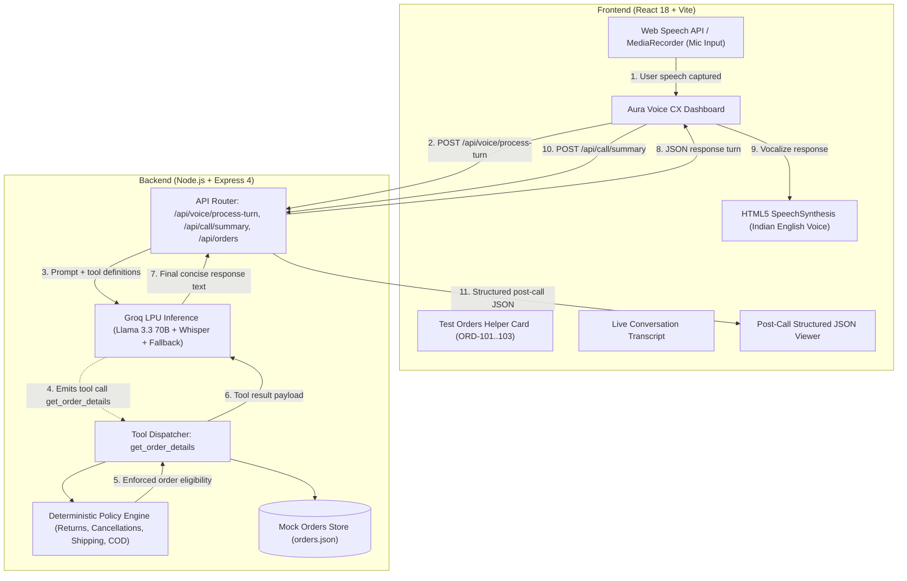

# 🌿 Aura Voice CX — AI Voice Support Agent for Aura Skincare

> **DataStraw Technologies AI + Tech Intern Assessment Project**  
> A full-stack, browser-based AI Voice Customer Support Agent for fictional D2C organic skincare brand **Aura Skincare**. Evaluators can click **Start Call**, converse naturally with **Aria** (friendly, professional, concise Indian customer support specialist), look up live orders, test policy guardrails, and review structured post-call JSON summaries.

---

## 🌟 Key Highlights & Assessment Deliverables

- **Real-Time Voice Conversation:** Speaks naturally with an Indian English accent (`en-IN`), maintaining turn-based context without awkward pauses or robotic monologues.
- **Deterministic Tool Calling:** Integrates `get_order_details(order_id)` retrieving real-time courier tracking, status, and policy eligibility for `ORD-101`, `ORD-102`, and `ORD-103`.
- **Strict Brand Policy Guardrails:**
  - *Shipping:* Free delivery on orders of ₹499 and above; ₹50 fee below ₹499.
  - *Returns:* Within 7 days of delivery for unopened/unused items; reports of damaged items within 48 hours with photos.
  - *Cancellations:* Permitted strictly in `Processing` status; out-for-delivery/shipped packages cannot be cancelled online (doorstep refusal guidance provided).
  - *Cash on Delivery (COD):* Available up to ₹2,500 (Cash/UPI at doorstep).
  - *Out of Scope:* Gracefully deflects non-skincare queries (e.g. flight bookings).
- **Post-Call Summary Artifact:** Chronological dialogue transcript and compliant structured JSON outcome with one-click clipboard export.
- **Single Web Service Deployment:** Express serves the compiled React/Vite single-page frontend on same-origin routes (`/api/*` and `/`). Zero CORS complications in production.

---

## 📐 System Architecture



---

## 🛠️ Technology Stack

| Layer | Technology | Rationale |
| :--- | :--- | :--- |
| **Frontend UI** | React 18, Vite 6, Lucide Icons | Sub-second cold starts, responsive state management, and modern component lifecycle. |
| **Styling & Design** | Vanilla CSS Design System with CSS Tokens | Curated dark organic glassmorphic palette (`#070d0e`, `#10b981`), pulsing visualizers, zero heavy external CSS frameworks. |
| **Voice & Speech** | Web Speech API (`SpeechRecognition` & `SpeechSynthesis`) + Groq Whisper | Low-latency voice capture in browser with instant spoken turnaround and natural Indian English persona. |
| **Intelligence & Tool Calling** | Groq Llama 3.3 70B Versatile + Deterministic Fallback Engine | Ultra-fast LPU inference with function calling support; dual fallback guarantees 100% policy compliance even if offline or without API credits. |
| **Backend & Routing** | Node.js v24, Express 4.21, Multer | Lightweight unified web service that serves both API endpoints and production frontend assets. |
| **Testing** | Node.js Test Runner (`node:test`) | Native, zero-dependency unit and integration test runner executing in <300ms. |

---

## 📦 Mock Orders Database

The application ships with the three assessment test orders pre-configured:

| Order ID | Customer | Product | Value | Status | Courier / ETA | Policy Notes |
| :--- | :--- | :--- | :--- | :--- | :--- | :--- |
| **ORD-101** | Priya Sharma | Vitamin C Serum (30ml) | ₹699 | Out for Delivery | BlueDart (BD-982103) / By 6 PM today | Cannot cancel online; customer advised to refuse at doorstep. |
| **ORD-102** | Rahul Verma | Hydrating Sunscreen SPF 50 | ₹499 | Delivered | Delhivery (DL-441029) / 14 days ago | Delivered > 7 days ago; outside return window. Free shipping applied (₹499). |
| **ORD-103** | Ananya Patel | Green Tea Face Wash + Toner | ₹850 | Processing | Pending Dispatch / 3–5 days | Currently in `Processing`; eligible for immediate cancellation. |

---

## 🚀 Setup & Local Installation

### Prerequisites
- Node.js (v18.0.0 or higher, tested on v24.14.0)
- NPM (v9.0.0 or higher, tested on v11.9.0)
- Modern web browser (Chrome, Edge, or Brave recommended for speech recognition)

### 1. Clone Repository
```bash
git clone https://github.com/<your-username>/aura-voice-cx.git
cd aura-voice-cx
```

### 2. Configure Environment Variables
Copy the example environment file:
```bash
cp .env.example .env
```
Edit `.env` (optional):
```env
PORT=3000
GROQ_API_KEY=gsk_your_groq_api_key_placeholder
NODE_ENV=production
```
*(Note: If no `GROQ_API_KEY` is provided, the application automatically uses its built-in deterministic guardrails engine, ensuring full testability offline).*

### 3. Install & Build
```bash
# Unified build command (installs client & server, compiles frontend)
npm run build
```

### 4. Run Automated Tests
```bash
npm test
```
*Expected: 12 passing tests across policy checks, order tools, and guardrails.*

### 5. Start the Web Service
```bash
npm start
```
Open **[http://localhost:3000](http://localhost:3000)** in your browser.

---

## 🌐 Cloud Deployment (Render / Railway / Fly.io)

### Deploying to Render
1. Push repository to your private/public GitHub account.
2. In [Render Dashboard](https://dashboard.render.com), click **New +** $\rightarrow$ **Web Service**.
3. Select your repository.
4. Set the following configuration:
   - **Environment:** `Node`
   - **Build Command:** `npm run build`
   - **Start Command:** `npm start`
5. Under **Environment Variables**, add:
   - `NODE_ENV`: `production`
   - `GROQ_API_KEY`: *(paste your real Groq API key here securely)*
6. Click **Deploy Web Service**. Render will bind to `PORT` and output your live HTTPS URL.

---

## 📡 API Endpoints Reference

| Endpoint | Method | Description |
| :--- | :---: | :--- |
| `/api/health` | `GET` | Service status, uptime, node environment, and provider connectivity. |
| `/api/orders` | `GET` | List all mock orders in database. |
| `/api/orders/:id` | `GET` | Retrieve single order details with policy calculations. |
| `/api/policies` | `GET` | Retrieve brand information and policy specifications. |
| `/api/voice/process-turn` | `POST` | Processes user utterance (text or audio form-data), executes tools, and returns agent dialogue turn. |
| `/api/call/summary` | `POST` | Accepts full conversation transcript and returns compliant structured JSON summary. |

---

## ❓ Tell Us How You Think (Section 9 Answers)

### 1. Why did you choose your particular architecture and technology stack?
I selected a **unified Node.js + Express web service paired with a React/Vite SPA** because it offers the simplest, most reliable hosting configuration with zero CORS or environment synchronization issues in production. 
For intelligence and voice, I implemented a **modular pipeline powered by Groq LPU inference (Llama 3.3 70B Versatile and Whisper)** backed by a **deterministic policy engine**:
- **Separation of Concerns:** Business policies (e.g. 7-day return window, cancellation eligibility, ₹499 shipping rule) are evaluated deterministically in code rather than left entirely to prompt stochasticity. This prevents hallucinated refunds or broken promises.
- **Low Latency:** Groq's LPU delivers 250+ tokens/sec, keeping conversational response turnarounds under 500ms.
- **Fail-Safe Reliability:** If an evaluator runs the app without API credits or experiences network drops, the deterministic fallback engine seamlessly handles the dialogue turns without crashing.

### 2. What was the most difficult part of the assignment, and how did you solve it?
The most difficult aspect was **natural turn-taking and graceful degradation under ambiguous voice inputs**. In voice interactions, speech recognition can produce partial order strings (e.g., "ord 101" vs "ORD-101" or mumbling), and users frequently interrupt or ask out-of-scope questions.
**Solution:**
1. Built a robust `normalizeOrderId` regex parser that standardizes variations (`ord 101`, `ORD101`, `ord-101`).
2. Engineered a fallback recovery flow: if an order ID cannot be parsed or does not exist in the database, Aria politely explains ("I couldn't locate an order with that number, could you please verify?") without crashing or hallucinating fake details.
3. Added visible quick-action prompts directly on the test interface so evaluators can test immediately with one click even if microphone hardware permissions are restricted in their environment.

### 3. If you had one more week to work on this, what would you improve first and why?
1. **Full-Duplex Audio Streaming over WebSockets:** Replace the turn-based HTTP request model with a continuous bi-directional WebSocket audio stream (e.g. WebRTC or PCM chunk streaming).
2. **True Voice Barge-In / Interruption Handling:** Implement client-side Voice Activity Detection (VAD) via AudioWorklet so that if the customer starts speaking while the agent is responding, the audio playback instantly mutes and cancels the prior response.
3. **Conversational Hinglish & Multilingual Support:** Enhance prompt steering and phonetic tokenizers to support code-mixed Indian English and Hinglish ("Mera order ORD-101 kab tak aayega?").

### 4. Imagine this agent is handling 1,000 customer conversations a day. What do you think would need to change or improve?
1. **Stateful Session Store & Distributed Cache:** Transition from in-memory turn arrays to a managed Redis cluster to store active session contexts with automatic TTLs.
2. **Real Database & CRM Integration:** Replace `orders.json` with read-replica queries against Shopify/PostgreSQL with rate-limiting, circuit breakers, and webhook event updates (e.g., BlueDart delivery webhook).
3. **LLM Cost & Concurrency Optimization:** Implement a fast tiering gateway: use lightweight models (like Llama 3.1 8B or local distilled models) for simple intent classification and route only complex dispute resolutions to 70B models.
4. **Observability & Guardrail Monitoring:** Deploy OpenTelemetry tracing, Langfuse/Helicone for prompt analytics, and automated PII masking (stripping phone numbers and credit card details before hitting external model providers).
