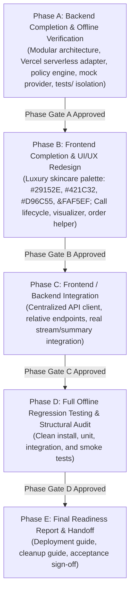

# Master Implementation Plan: Aura Skincare Voice CX

**Project Objective:** Transform Aura Skincare Voice CX into a fully functional, Vercel-compatible full-stack voice application with modular backend architecture, deterministic brand guardrails, pluggable AI provider, and a bespoke luxury skincare UI.

**Repository:** `https://github.com/sujalmirgule/Voice_AI_Agent`

---

## Strict Phased Roadmap

---

## Phase A: Backend Completion (Current Focus)

1. **A1. Existing Implementation Inspection & Audit:**
   - Documented in `docs/backend-audit.md`.
2. **A2. Backend Architecture Modularization:**
   - `server/src/config/`: Configuration & environment variable validation.
   - `server/src/middleware/`: Validation & centralized error handling.
   - `server/src/controllers/`: Order, voice, and summary controllers.
   - `server/src/services/`: AI provider adapter (`aiProvider.js`), speech service, summary generator.
   - `api/index.js` & `vercel.json`: Vercel serverless function entrypoint.
3. **A3. API Functionality & Reference:**
   - Full documentation in `docs/api-reference.md`.
4. **A4. Deterministic Brand Policy Engine:**
   - Shipping: free >= ₹499, ₹50 < ₹499, 3-5 days delivery.
   - Returns: 7 days unopened in original packaging; 48 hours for damaged with photos.
   - Cancellation: strictly in `Processing`.
   - COD: up to ₹2,500 via cash or UPI.
5. **A5. Pluggable AI Provider Adapter:**
   - Groq LPU adapter (`llama-3.3-70b-versatile` & `whisper-large-v3-turbo`) with 8s timeouts.
   - Hermetic `MockAiProvider` for offline testing without API keys.
6. **A6. Speech Pipeline Audit:**
   - Clear architectural distinction between browser Web Speech API and server-side Whisper.
7. **A7. Dedicated Root `tests/` Directory:**
   - `tests/backend/`: unit tests for api, policies, orders, conversation, summary, validation, errors.
   - `tests/integration/`: end-to-end API flows.
   - `tests/fixtures/`: static JSON fixtures.
   - `tests/mocks/`: mock AI provider.
   - `tests/helpers/`: test server setup.
8. **A8. Backend Phase Gate:**
   - Run 100% passing backend tests and report results before Phase B.

---

## Phase B: Frontend Redesign (Pending Phase A)
- Implement bespoke warm luxury skincare palette (Deep aubergine `#29152E`, Black cherry `#421C32`, Burnt coral `#D96C55`, Muted terracotta `#BC765B`, Warm champagne `#F1D7B8`, Soft ivory `#FAF5EF`).
- Eliminate generic neon/blue gradients and glassmorphism.
- Responsive layout, accessible call controls, audio visualizer, test orders helper, and post-call drawer.

---

## Phase C: Integration (Pending Phase B)
- Centralized API client in `client/src/lib/api.js`.
- Same-origin relative paths `/api/*`.
- State synchronization between live speech and backend turns.

---

## Phase D: Full Offline Regression Testing
- Multi-suite test run (unit, integration, smoke).
- Vercel build verification.

---

## Phase E: Final Readiness & Cleanup Plan
- `docs/cleanup-guide.md` specifying temporary vs permanent files.
- Final handoff documentation.
