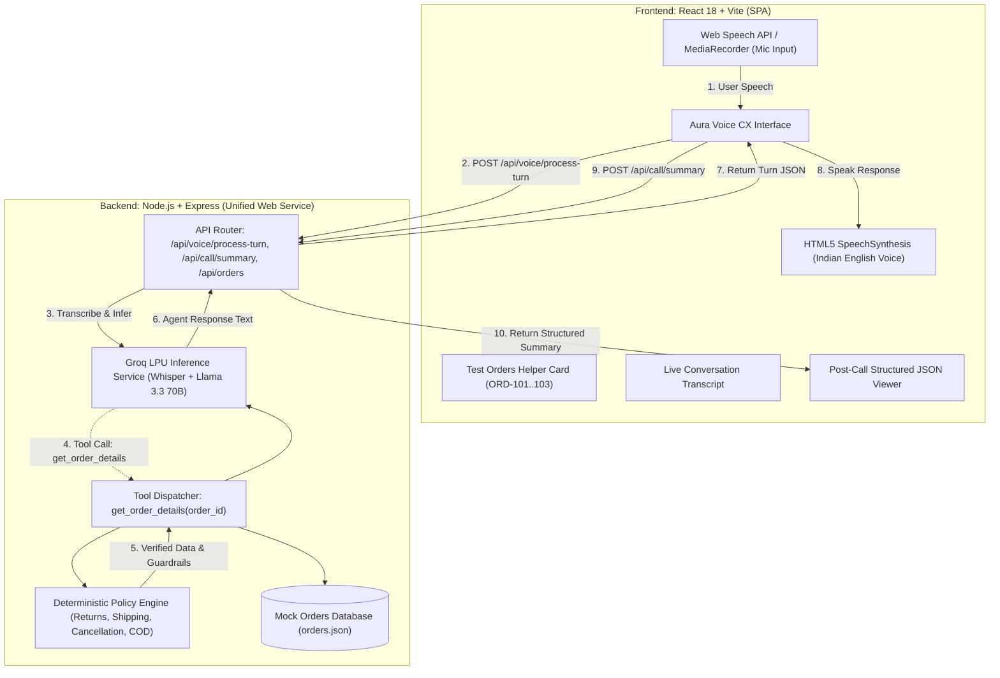

# Implementation Plan: Aura Skincare AI Voice CX Agent

## Project Overview
A browser-based AI Voice Customer Support Agent for **Aura Skincare**, a premium organic Indian D2C skincare brand. Evaluators can click "Start Call", speak naturally through their microphone, receive spoken responses from **Aria** (friendly, professional, concise Indian English support specialist), query live order information (`ORD-101`, `ORD-102`, `ORD-103`), enforce strict brand policies, and review chronological transcripts and structured JSON call outcomes.

---

## Architecture & Technology Stack

---

## Phase Breakdown

### Phase 0: Environment Audit & Prerequisites (Completed)
- Node.js v24.14.0, NPM 11.9.0, Git verified.
- Clarified business policy: orders of ₹499 and above receive Free Delivery.
- Formulated Groq LPU + modular pipeline architecture.

### Phase 1: Project Scaffolding & Data Modeling (Completed)
- Unified monorepo structure with single Node.js entry point (`server/src/server.js`) serving static React build (`client/dist`).
- Seeded `server/src/data/orders.json` with ORD-101, ORD-102, ORD-103.
- Configured `.gitignore` and `.env.example`.

### Phase 2: Brand Policies & Tool Calling Engine (Completed)
- Built `server/src/policies/brandPolicies.js` (Shipping, 7-day returns, Processing cancellation, COD up to ₹2,500).
- Built `server/src/tools/orderTool.js` (`get_order_details` tool handler with ID normalization).
- Implemented `server/src/services/groqService.js` supporting Llama 3.3 70B function calling + deterministic fallback engine.

### Phase 3: Conversational Pipeline & Summary Generator (Completed)
- Created `/api/voice/process-turn` handling speech turns, prompt steering, and tool invocation.
- Built `server/src/services/summaryService.js` to schematize post-call JSON summary (`customer_intent`, `order_id`, `resolution_status`, `call_summary`).
- Created `/api/health` and `/api/orders` endpoints.

### Phase 4: Frontend Development & Aesthetics (Completed)
- Designed rich, dark-mode glassmorphic UI matching organic Indian skincare branding.
- Implemented Start/End Call lifecycle, pulsing audio visualizer, listening/thinking/speaking state pills.
- Added visible Test Orders Helper card with quick-query actions.
- Built live conversation transcript and post-call summary modal with one-click JSON copy.

### Phase 5: Testing & Quality Assurance (Completed)
- 12 comprehensive automated tests covering policy edge cases, order lookups, and guardrails.
- Production build validation (`npm run build`).
- End-to-end REST API validation of all endpoints.

### Phase 6: Deployment & Submission Preparation (Current)
- Unified single-port deployment ready for Render / Railway / Fly.io.
- Documentation, demo video outline, answers to assessment questions, and email submission template.
