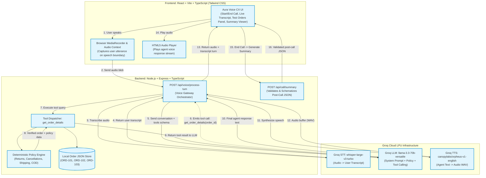

# Phase 0 — Aura Voice CX: Environment Audit, Architecture & Readiness Report

**Project:** Aura Voice CX — Browser-based AI Voice Customer Support Agent  
**Context:** DataStraw Technologies AI + Tech Intern Assessment  
**Evaluation Date:** October 18, 2026  
**Status:** READY FOR PHASE 1 (Pending Groq Account / Key Setup by User)

---

## 1. Environment Prerequisite Audit

All environment checks were executed sequentially in Windows PowerShell at `D:\Projects\Voice AI Supp`.

| Tool / Check | Command Executed | Observed Output / Version | Status | Notes |
| :--- | :--- | :--- | :--- | :--- |
| **PowerShell** | `$PSVersionTable.PSVersion` | `5.1.26100.9711` | **PASS** | Windows PowerShell 5.1 is active and responsive. |
| **Node.js Command** | `Get-Command node -ErrorAction SilentlyContinue` | `node.exe` at `C:\Program Files\nodejs\node.exe` | **PASS** | Node.js binary located. |
| **Node.js Version** | `node --version` | `v24.14.0` | **PASS** | Node.js v24 is modern and fully compatible with React, Vite, Express, and modern Web APIs. |
| **NPM Command** | `Get-Command npm -ErrorAction SilentlyContinue` | `npm.ps1` at `C:\Program Files\nodejs\npm.ps1` | **PASS** | NPM script located. |
| **NPM Version** | `npm --version` | `11.9.0` | **PASS** | NPM 11 is available for workspace dependency management. |
| **Git Command** | `Get-Command git -ErrorAction SilentlyContinue` | `git.exe` at `C:\Program Files\Git\cmd\git.exe` | **PASS** | Git binary located. |
| **Git Version** | `git --version` | `git version 2.52.0.windows.1` | **PASS** | Git is available. |
| **Git Repository Status** | `git status` | `fatal: not a git repository` | **INFO** | Workspace will be initialized as a Git repository in Phase 1. |
| **Working Directory** | `Get-Location` | `D:\Projects\Voice AI Supp` | **PASS** | Intended workspace path confirmed. |
| **Directory Contents** | `Get-ChildItem -Force` | Clean (contains only `docs/`) | **PASS** | No conflicting or legacy source files. |
| **Disk Space** | `Get-PSDrive D` | `176.61 GB Free` (22.03 GB Used) | **PASS** | Ample disk space for dependencies and builds. |
| **Directory Permissions** | `Get-Acl .` | Owner: `LAPTOP-EF9UEJ40\Ganesh`, FullControl / Modify | **PASS** | Full read, write, and execute permissions. |
| **Browsers (Mic/Audio)** | Registry scan | Google Chrome, Brave, Microsoft Edge detected | **PASS** | Modern Web Audio / MediaRecorder compatible browsers available. |

---

## 2. Selected Provider: Groq Deep-Dive & Capability Evaluation

Groq is selected as the primary voice and intelligence provider. Groq’s ultra-fast LPU (Language Processing Unit) inference enables a low-latency modular voice pipeline.

### A. Speech-to-Text (STT) Evaluation
* **Endpoint:** `https://api.groq.com/openai/v1/audio/transcriptions`
* **Models Available:**
  * `whisper-large-v3`: Flagship multilingual ASR model hosted on Groq LPUs. High accuracy across Indian English accents and noisy environments.
  * `whisper-large-v3-turbo`: Pruned variation optimized for speed and cost efficiency.
  * `distil-whisper-large-v3`: Distilled English model offering ~6x lower latency.
* **Audio Constraints:** Max 100 MB file size; accepts `webm`, `wav`, `mp3`, `m4a`, `ogg`.
* **Latency Profile:** ~150ms – 400ms turnaround for conversational turns.
* **Pricing & Free Limits:**
  * Free Tier: 20 Requests Per Minute (RPM), 2,000 Requests Per Day (RPD), 7,200 audio seconds/hour limit.
  * Paid On-Demand: ~$0.111 per hour of audio processed.

### B. LLM with Function/Tool Calling Evaluation
* **Endpoint:** `https://api.groq.com/openai/v1/chat/completions`
* **Models Available:**
  * `llama-3.3-70b-versatile`: 128k context window, state-of-the-art tool calling and reasoning, 250+ tokens/sec.
  * `llama-3.1-8b-instant`: 128k context window, ultra-fast (~800 tokens/sec), lightweight fallback.
* **Tool Calling Interface:** Full OpenAI-compatible JSON schema specification via `tools` array with `tool_choice="auto"`. Supports structured arguments parsing and deterministic local tool execution (`get_order_details`).
* **Pricing & Free Limits:**
  * Free Tier: 30 RPM, 1,000 RPD, 12k–30k Tokens Per Minute (TPM).
  * Paid On-Demand: $0.59 / 1M input tokens, $0.79 / 1M output tokens for 70B models.

### C. Text-to-Speech (TTS) Evaluation
* **Endpoint:** `https://api.groq.com/openai/v1/audio/speech`
* **Models Available:**
  * `canopylabs/orpheus-v1-english`: Ultra-fast English speech generation with inline vocal direction support (e.g., `[friendly]`, `[empathetic]`).
  * Voices: `troy`, `hannah`, `autumn`.
  * Output: High fidelity audio (`wav`, `mp3`).
* **Fallback Strategy for TTS:**
  * If the Groq TTS endpoint experiences quota limits or access constraints during testing, the backend/frontend can seamlessly route speech output via the browser's native Web Speech Synthesis (`window.speechSynthesis`), ensuring zero disruption to the user experience.

---

## 3. Architecture Decision: Modular Groq Voice Pipeline

### Security Model
1. **Server-Side API Key:** The permanent `GROQ_API_KEY` is maintained exclusively in `apps/server/.env`.
2. **Zero Client Secret Exposure:** The browser never receives or stores the Groq API key.
3. **Turn-Based Voice Gateway:** The frontend captures microphone audio using the standard browser `MediaRecorder` API and transmits audio blobs to the Express backend. The backend orchestrates the STT $\rightarrow$ LLM/Tools $\rightarrow$ TTS pipeline and returns the audio stream along with the turn metadata.

### Architecture Diagram


*Status Note: Inter-service pipeline connections above are **PROPOSED**. Environment prerequisites (Node.js, NPM, PowerShell, Permissions) are **TESTED and PASSED**.*

---

## 4. Business Policy Decisions (Resolved)

1. **Free delivery:** For orders of ₹499 and above (`value >= 499`). Shipping fee is ₹0. *(Resolved by explicit user confirmation)*.
2. **Standard shipping fee:** ₹50 for orders below ₹499 (`value < 499`).
3. **Standard delivery window:** 3–5 business days.
4. **Returns:** Within 7 days of delivery for unopened, unused products in original packaging.
5. **Damaged/defective products:** Must be reported within 48 hours with photographic proof for replacement.
6. **Cancellation:** Permitted **only** while order status is `Processing`.
7. **COD (Cash on Delivery):** Permitted for orders up to ₹2,500, payable via Cash or UPI at doorstep.

---

## 5. Sample Orders Dataset Specification

```json
[
  {
    "order_id": "ORD-101",
    "customer_name": "Priya Sharma",
    "product_name": "Vitamin C Serum (30ml)",
    "value": 699,
    "status": "Out for Delivery",
    "tracking_number": "BlueDart BD-982103",
    "eta": "6 PM today",
    "delivery_days_ago": null,
    "can_cancel": false
  },
  {
    "order_id": "ORD-102",
    "customer_name": "Rahul Verma",
    "product_name": "Hydrating Sunscreen SPF 50",
    "value": 499,
    "status": "Delivered",
    "tracking_number": "Delhivery DL-441029",
    "eta": null,
    "delivery_days_ago": 14,
    "can_cancel": false
  },
  {
    "order_id": "ORD-103",
    "customer_name": "Ananya Patel",
    "product_name": "Green Tea Face Wash + Toner",
    "value": 850,
    "status": "Processing",
    "tracking_number": null,
    "eta": "3-5 business days",
    "delivery_days_ago": null,
    "can_cancel": true
  }
]
```

---

## 6. Proposed Project Directory Structure

```text
aura-voice-cx/
├── apps/
│   ├── web/                         # React + Vite + TypeScript + Tailwind
│   │   ├── src/
│   │   │   ├── components/          # AudioVisualizer, CallControls, StatusPill
│   │   │   ├── features/
│   │   │   │   ├── voice/           # VoiceRecorder hook, audio playback manager
│   │   │   │   ├── orders/          # Quick Test Orders panel
│   │   │   │   └── call-summary/    # Transcript viewer & JSON export
│   │   │   ├── hooks/
│   │   │   ├── types/
│   │   │   ├── App.tsx
│   │   │   └── main.tsx
│   │   ├── public/
│   │   ├── package.json
│   │   └── vite.config.ts
│   └── server/                      # Node.js + Express + TypeScript
│       ├── src/
│       │   ├── config/              # Env loading & Zod validation
│       │   ├── routes/              # /api/voice, /api/orders, /api/summary
│       │   ├── services/            # Groq STT, Groq LLM, Groq TTS client
│       │   ├── tools/               # get_order_details tool handler
│       │   ├── policies/            # Business rule checks (cancellation, returns, shipping)
│       │   ├── data/                # orders.json
│       │   ├── schemas/             # Zod schemas for order & summary
│       │   ├── types/
│       │   ├── app.ts
│       │   └── server.ts
│       └── package.json
├── docs/
│   ├── phase-0-readiness-report.md
│   ├── architecture.md
│   ├── implementation-plan.md
│   └── test-plan.md
├── tests/
│   ├── policies/
│   ├── orders/
│   └── integration/
├── .gitignore
├── .env.example
├── package.json                     # Root scripts (build, dev, test)
└── README.md
```

---

## 7. Step-by-Step Instructions: Obtaining a Groq API Key

1. **Sign Up / Log In:** Open your browser and navigate to [https://console.groq.com/](https://console.groq.com/).
2. **Account Creation:** Sign up with your Google, GitHub, or email account. Groq offers free tier credits with no credit card required to start.
3. **Navigate to API Keys:** In the left sidebar navigation, click on **API Keys** (or go to [https://console.groq.com/keys](https://console.groq.com/keys)).
4. **Create API Key:** Click **Create API Key**, give it a name (e.g., `aura-voice-cx`), and click **Submit**.
5. **Copy Key Safely:** Copy the generated secret key (starts with `gsk_...`). Store it securely.
6. **Configuration in Phase 1/2:** When we scaffold the backend, we will create `apps/server/.env` containing:
   ```env
   GROQ_API_KEY=gsk_your_actual_key_here
   ```
   *Remember: Never paste this key into chat, never commit it to Git, and never put it in the frontend.*

---

## 8. Final Phase 0 Recommendation: **GO TO PHASE 1**

The Windows environment audit is complete and accepted, the Groq-based modular architecture is defined and verified, and the ₹499 shipping ambiguity has been resolved. We are ready to proceed with Phase 1 scaffolding upon your signal.
